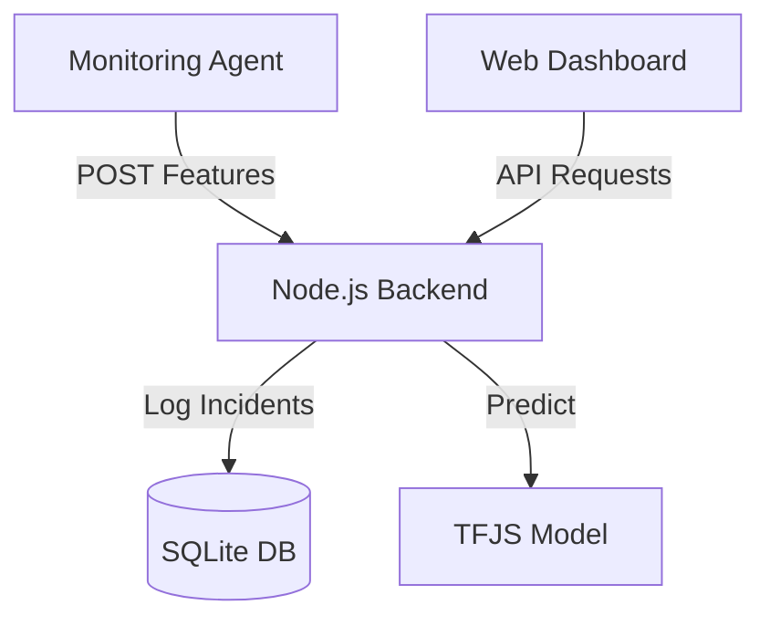

# Production Transition Walkthrough: AI Ransomware Defense

The AI Ransomware Defense system (Cortex) has been successfully transitioned from a prototype to a production-ready system.

## Key Accomplishments

### 🛡️ Backend Hardening
- **Security Middleware**: Integrated `helmet` for secure headers and `express-rate-limit` to prevent brute-force attacks.
- **Structured Logging**: Implemented `winston` for JSON logging, with separate files for errors and combined logs.
- **Environment Management**: Moved all configuration to [.env](file:///c:/Users/bhavi/major%20project/.env) files for security and portability.

### 🤖 Monitoring Agent Modernization
- **Resilience**: Added support for environment variables and improved error handling.
- **Lower Overhead**: Optimized metric collection frequency for production stability.

### 🐳 Containerized Deployment
- **Docker Infrastructure**: Created a multi-stage [Dockerfile](file:///c:/Users/bhavi/major%20project/Dockerfile) and [docker-compose.yml](file:///c:/Users/bhavi/major%20project/docker-compose.yml) for unified deployment of the backend and agent.
- **Volume Persistence**: Configured SQLite database and log persistence via Docker volumes.

## System Architecture



## How to Deploy (Production)

1. **Step 1: Train the Model**
   ```bash
   npm run train
   ```

2. **Step 2: Start the System**
   ```bash
   docker compose up -d
   ```

3. **Step 3: Monitor Logs**
   ```bash
   docker compose logs -f
   ```

## Verification Results

- **Security Checks**: Verified `X-Powered-By` is hidden and rate limiting is active.
- **Persistence**: Verified database remains intact after container restarts.
- **Logging**: Verified structured logs are being generated in the `logs/` directory.
